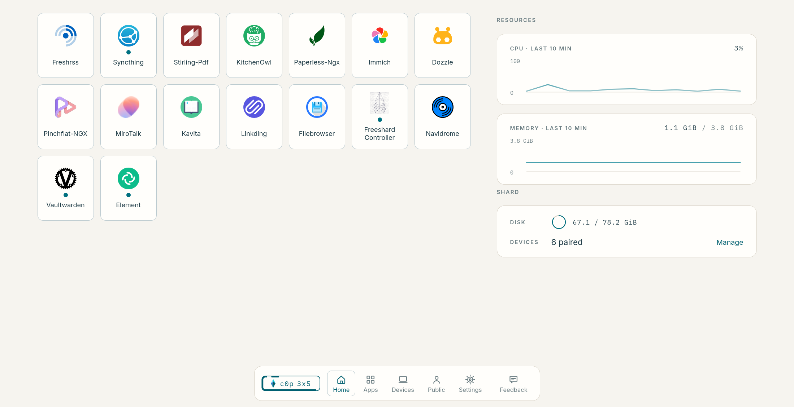
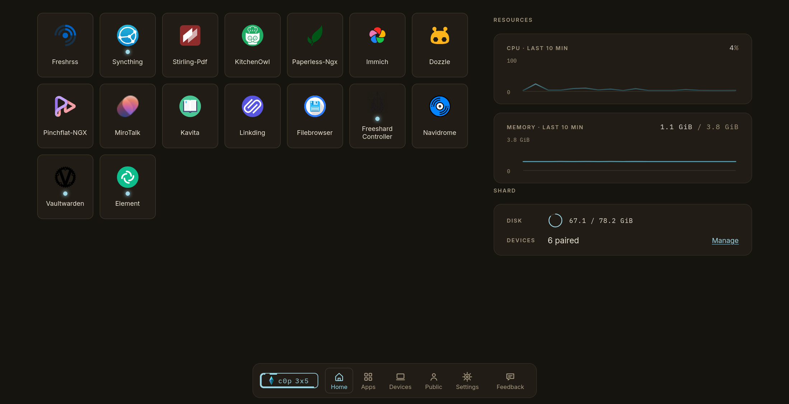
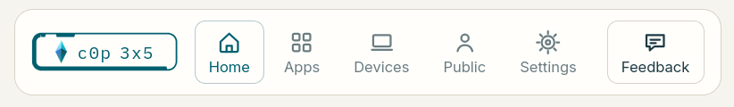

Seit es Freeshard gibt, zeigt das Web-Terminal, also das, was du tatsächlich jeden Tag benutzt, sein Alter. Es hat funktioniert, aber jedes neue Feature bedeutete einen Kampf gegen ein Fundament, das seine ursprüngliche Form längst gesprengt hatte, und mehr noch: Es sah einfach alt und abgenutzt aus. Irgendwann habe ich aufgehört, es zu flicken, und von vorne angefangen.

Diese Neuentwicklung hat einen schönen Namen: Sundial, aufgebaut um eine Designsprache, die wir Daylight Instrument nennen, dazu mehr weiter unten. Sie läuft seit Juli parallel zur alten Oberfläche auf meinem eigenen Shard. Ich betreibe damit [Dogfooding](https://en.wikipedia.org/wiki/Eating_your_own_dog_food), nutze sie also im ganz normalen Alltag für meine eigenen Sachen, und inzwischen ist sie nah genug an Funktionsgleichheit, und an manchen Stellen sogar besser, dass ich finde: Sie sollte jetzt die Oberfläche auf jedem Shard werden.

## Was es eigentlich ist

Sundial ist eine Neuentwicklung von Grund auf, leichter und einfacher als die App, die sie ersetzt, spricht aber mit demselben Shard, den du schon immer im Hintergrund hattest. Es kann alles, was die alte App konnte: deine Apps, deine gekoppelten Geräte, deine öffentliche Seite, deine Einstellungen. Dazu kommen ein paar Dinge, die es vorher nicht gab: ein Ressourcen-Monitor direkt auf dem Startbildschirm, auf einen Blick zu sehen, was dein Shard gerade eigentlich tut, ein Dark Mode, die Möglichkeit, es wie eine native App auf dem Handy zu installieren, und eine Oberfläche auf Englisch oder Deutsch, je nachdem, wie dein Browser eingestellt ist. Wenn du eine andere Sprache möchtest, [sag uns Bescheid](mailto:contact@freeshard.net).

*Start: deine Apps und dein Ressourcen-Monitor, auf einen Blick.*

## Warum es so aussieht, wie es aussieht

Der Gestaltungsstil, den wir dafür entwickelt haben, hat einen Namen: Daylight Instrument. Der Bezugspunkt, auf den wir immer wieder zurückkamen, war ein Bildschirm auf einer Raumschiffbrücke, wie bei [The Expanse](https://www.imdb.com/title/tt3230854/): dünne, helle Linien, nichts gezeichnet, was nicht etwas bedeutet, Funktion vor allem. Das haben wir dann umgedreht: Was dunkel und kinoreif war, wurde hell und alltäglich, denn wie sich die Oberfläche eigentlich anfühlen sollte, war kein Cockpit, sondern ein Instrument, dem du vertraust: ruhig, präzise, und zufrieden damit, bei Tageslicht auf einem Regal zu stehen, statt im Dunkeln zu leuchten. Die [Landingpage](https://freeshard.net), die du vermutlich gerade ansiehst, hat sich vor ein paar Tagen genau diesen Stil zugelegt, es ist also längst nicht mehr nur der Look von Sundial, sondern wird der von Freeshard.

*Derselbe Bildschirm, Dark Mode. Gleiches Gerüst, anderes Licht.*

Jemand, der sich früh einen Mockup angesehen hat, sagte, das sehe aus wie IKEA, und meinte das positiv. Ich habe das ins Briefing aufgenommen. IKEAs eigene Designphilosophie, gutes Design, das für alle zugänglich ist statt ein Luxusgut, kommt dem, was Freeshard eigentlich will, sehr nahe: seine eigene kleine Ecke des Internets zu betreiben soll etwas sein, das jeder kann, nicht nur Leute, die sich mit Servern schon wohlfühlen. Die schwedische Idee von *Lagom*, ungefähr "genau die richtige Menge, nicht mehr", wurde zur Arbeitsregel: zeig, was du gerade brauchst, und sonst nichts. Ein untätiger Shard sollte untätig aussehen. Keine Badges, die dich drängen, ein Feature zu erkunden, keine "Wusstest du schon"-Karten, kein künstlicher Grund zu bleiben.

Derselbe Instinkt zeigt sich auch darin, wie Entscheidungen präsentiert werden. Ein Bestätigungsdialog gibt beiden Schaltflächen, Fortfahren und Abbrechen, das gleiche visuelle Gewicht und erklärt in klarer Sprache, was als Nächstes passiert. Nichts ist schon für dich vorausgewählt. Nichts ist so formuliert, dass die auffälligere Option die ist, die du am Ende bereust. Wenn der eigene Server dich wieder ans Steuer setzen soll, sollte die Oberfläche dich bei einer Entscheidung nicht in eine Richtung drängen.

Die Tastaturnavigation hat genauso viel Sorgfalt bekommen wie das Aussehen: ein vollwertiger Weg, die ganze App zu bedienen, kein nachträglicher Gedanke. Jeder Teil von Sundial funktioniert allein über die Tastatur, Pfeiltasten zum Bewegen, Buchstabenkürzel, um direkt zu einem Ziel zu springen. Auch das Menü ist umgezogen, von einer Leiste oben zu einem Dock unten, näher an dem, wie macOS oder GNOME das machen, vor allem weil es mit dem Daumen auf dem Handy viel leichter zu erreichen ist.

## Das Badge, das beweist, dass es dein Shard ist

Jeder Shard bekommt ein kleines Badge, das Diamant-Logo neben einer kurzen ID, gedacht fürs Dock, aber genauso gut gedruckt auf einem Sticker oder einer Kiste. Der Rahmen darum ist keine Dekoration: Sein Muster aus dicken und dünnen Linien wird aus der ID deines eigenen Shards berechnet, sodass jedes Shard-Badge optisch einzigartig ist und derselbe Shard immer denselben Rahmen zeichnet. Die Idee ist, dass du deinen auf einen Blick wiedererkennst, so wie man ein Gesicht wiedererkennt, ganz ohne die ID zu lesen. Es ist das neueste Stück des Designs und das, bei dem wir uns am wenigsten sicher sind: Wenn es dir nicht wirklich hilft, deinen Shard von jedem anderen zu unterscheiden, [sag uns auch das](mailto:contact@freeshard.net).

*Das hier ist meins. Deiner zeichnet einen anderen Rahmen.*

## Was das für deinen Shard bedeutet

Nichts davon ändert, was Freeshard tut. Es ändert, wie es sich anfühlt, es zu benutzen, und es räumt still ein paar Dinge aus dem Weg, die mich selbst jedes Mal gestört haben, wenn ich die alte App benutzt habe: ein Menü, das auf dem Handy nie richtig funktioniert hat, Bestätigungsdialoge, die nicht fair gespielt haben.

Ein kurzer Blick voraus auf zwei Dinge, die noch kommen und auf diesem neuen Fundament landen statt auf dem alten: eine echte Neugestaltung des App Stores und ein OIDC-basierter Login, bei dem das Koppeln deines Geräts mit deinem Shard dich automatisch bei allen deinen Apps einloggt. Dass du dir damit ein Passwort sparst, ist der kleine Vorteil davon. Der größere ist, dass ein Familienmitglied oder ein kleines Team einen eigenen Account auf deinem Shard bekommen kann, bei dem du bestimmst, was sie dürfen, und sich über genau diesen einen Account bei jeder App einloggt, statt einen eigenen pro App und Person zu brauchen. Das ist ein großer Schritt, weil es die Natur eines Shards grundsätzlich von einem Einzelnutzer-Produkt zu einem teilbaren macht. Aber dazu mehr später. Beides ist noch nicht live, beides ist aber nah.

Das ist jetzt die Oberfläche, auf jedem Shard. Es gibt keine klassische Version mehr, zu der du zurückwechseln kannst. Wenn dir etwas davon wirklich im Weg steht, sag es: Im Dock gibt es einen **Feedback**-Button für eine kurze, einmalige Nachricht, oder schreib direkt an [contact@freeshard.net](mailto:contact@freeshard.net), wenn du eine echte Antwort willst.

Noch keinen eigenen Shard? [Teste Freeshard 24 Stunden kostenlos](https://freeshard.net/de/trial/) und sieh dir Sundial direkt selbst an.
